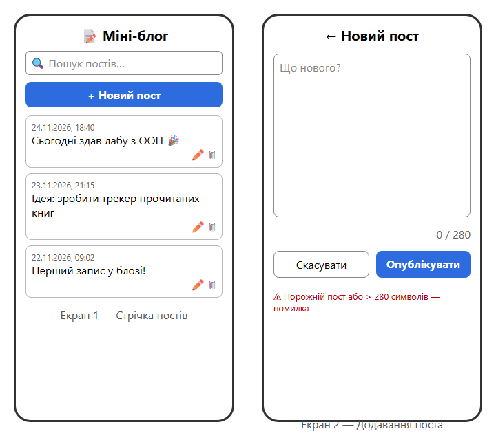

# Лабораторна робота №3. SDLC — Міні-блог
**Студент:** П.М., група 372 · **Варіант 19:** Міні-блог — додавання коротких постів з датою (без публікації назовні).

## 1. Планування
**Мета продукту:** простий застосунок «Міні-блог», у якому користувач пише короткі пости, бачить їх у хронологічному порядку з датою публікації, може редагувати та видаляти їх. Дані зберігаються локально (без публікації в Інтернеті).

> Користувач повинен мати можливість швидко записати думку у вигляді короткого поста з датою та переглянути всі свої пости в одній стрічці.

## 2. Аналіз вимог (User stories)
1. Як користувач, я хочу додавати короткий пост (до 280 символів), щоб зберегти свою думку. ✅ **Must have**
2. Як користувач, я хочу бачити стрічку постів від нових до старих з датою і часом, щоб знайти потрібний запис. ✅ **Must have**
3. Як користувач, я хочу редагувати пост, щоб виправити помилку.
4. Як користувач, я хочу видаляти пост, щоб прибрати непотрібний запис.
5. Як користувач, я хочу шукати пости за словом, щоб швидко знайти потрібний запис.

## 3. Дизайн (Прототип)


*Екран 1 — «Стрічка»: заголовок, поле пошуку, кнопка «+ Новий пост», список постів (дата/час, текст, кнопки ✏️ і 🗑).
Екран 2 — «Новий пост»: поле тексту з лічильником символів (0/280), кнопки «Опублікувати» і «Скасувати».*

## 4. Реалізація (псевдокод ключової функції — додавання поста)
```pseudo
const MAX_LENGTH = 280

function addPost(text):
    text = trim(text)
    if text is empty:
        return "Error: Post cannot be empty"
    if length(text) > MAX_LENGTH:
        return "Error: Post is longer than 280 characters"
    post = { id: generateId(), text: text, createdAt: now() }
    posts.insertAtBeginning(post)      // нові пости зверху
    saveToLocalStorage(posts)
    return "Post added"
```

## 5. Тестування
| № | Перевірка | Очікуваний результат |
|---|-----------|----------------------|
| 1 | Додати пост «Перший запис у блозі» | Пост з'являється на початку стрічки з поточною датою і часом |
| 2 | Додати порожній пост (або лише пробіли) | Повідомлення «Post cannot be empty», пост не додається |
| 3 | Додати текст із 281 символу | Повідомлення про перевищення довжини, пост не додається |
| 4 | Додати два пости поспіль | Новіший пост відображається вище за старіший |
| 5 | Перезавантажити сторінку | Усі пости залишаються у стрічці (збережені локально) |

## 6. Висновки
Для Міні-блогу найкраще підходить **Agile** (Scrum/Kanban із короткими ітераціями): спочатку випускається MVP (додавання та стрічка постів), а далі поступово додаються редагування, пошук, теги за відгуками користувачів. Waterfall надто жорсткий для продукту, вимоги до якого уточнюються під час використання, а Spiral з аналізом ризиків — надто важкий для невеликого застосунку.
